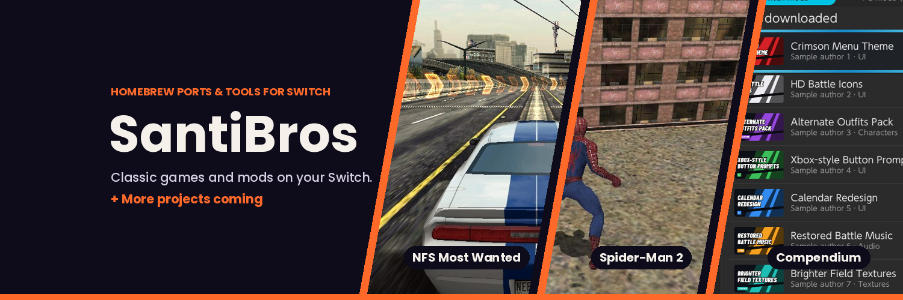
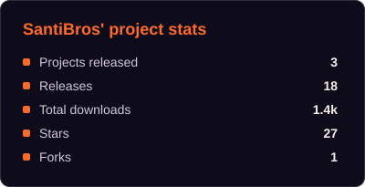
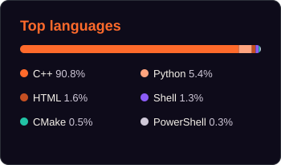

# Hi, I'm SantiBros 👋

**🎮 I bring classic games to the Nintendo Switch as free, open-source homebrew ports.**

---

## 🕹️ My ports

<table>
<tr>
<td width="50%" valign="top">

### 🏎️ [NFS Most Wanted 2012 (Android)](https://github.com/SantiBros/NFSMostWanted2012-Android-Switch)

The Android version of Most Wanted (2012), running on Switch.

- 📺 720p handheld, 1080p docked
- 🎮 Full controller support and optional gyro steering
- 📴 Fully offline, with a debug menu for performance settings

**[⬇️ Download](https://github.com/SantiBros/NFSMostWanted2012-Android-Switch/releases/latest)** · **[📖 Install guide](https://github.com/SantiBros/NFSMostWanted2012-Android-Switch#how-to-install)**

</td>
<td width="50%" valign="top">

### 🕷️ [Spider-Man 2 (Xbox, 2004)](https://github.com/SantiBros/SpiderMan2-2004-NX)

The original Xbox game, swinging through New York on Switch.

- 📺 480p, 720p and 1080p docked
- 🖼️ 16:9 widescreen or 4:3 with custom side borders
- 📳 Vibration and a debug menu

**[⬇️ Download](https://github.com/SantiBros/SpiderMan2-2004-NX/releases/latest)** · **[📖 Install guide](https://github.com/SantiBros/SpiderMan2-2004-NX#how-to-install)**

</td>
</tr>
</table>

> [!NOTE]
> You need your own copy of the original games. No game files are included in any of my
> projects, so please don't ask for them.

## 📋 Port status

| Port | Original platform | Latest version | Status |
| --- | --- | --- | --- |
| 🏎️ [NFS Most Wanted 2012](https://github.com/SantiBros/NFSMostWanted2012-Android-Switch) | Android |  | 🟢 Playable, in active development |
| 🕷️ [Spider-Man 2](https://github.com/SantiBros/SpiderMan2-2004-NX) | Original Xbox (2004) |  | 🟢 Playable, in active development |
| ❓ Next port | Coming soon | | 🔜 In the works |

## 📰 Latest releases

<!-- RELEASES:START -->
- Loading...
<!-- RELEASES:END -->

Updated automatically from the ports' GitHub releases.

## 🛠️ What I work with

Reverse engineering, CPU recompilation, graphics translation and a lot of testing on real hardware. 🔍

## 📊 GitHub stats

<picture>
  <source media="(prefers-color-scheme: dark)" srcset="https://raw.githubusercontent.com/SantiBros/SantiBros/output/snake-dark.svg">
  <source media="(prefers-color-scheme: light)" srcset="https://raw.githubusercontent.com/SantiBros/SantiBros/output/snake.svg">
  
</picture>

## 🔜 What's next

More ports are on the way! ⭐ Star and 👀 watch the repos to get notified about new releases.

## 🐛 Found a bug?

Open an issue in the port's repo and attach the log file from the port's folder. Reports in
English or Spanish are welcome.

## 🤝 Connect

## ☕ Support

Every port takes many hours of reverse engineering, testing and bug fixing. If you enjoy my work,
you can support it on Ko-fi. It helps me keep the ports updated and make new ones! ❤️

---

<b>🇪🇸 En español</b>

 

Llevo juegos clásicos a Nintendo Switch como ports homebrew gratuitos y de código abierto:

- 🏎️ **[NFS Most Wanted 2012 (Android)](https://github.com/SantiBros/NFSMostWanted2012-Android-Switch/blob/main/README.es.md)**
- 🕷️ **[Spider-Man 2 (Xbox, 2004)](https://github.com/SantiBros/SpiderMan2-2004-NX/blob/main/README.es.md)**

¡Y vienen más! Necesitas tu propia copia de los juegos originales; ningún proyecto incluye
archivos del juego. Si encuentras un error, abre un issue en el repositorio del port.

Si te gustan mis ports, puedes apoyarme en [Ko-fi](https://ko-fi.com/S4I32A0WMU). ¡Gracias! ❤️

